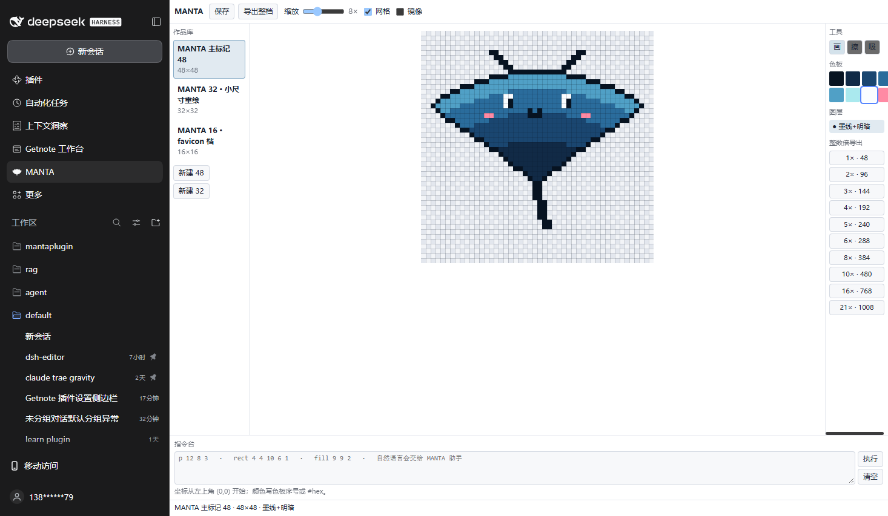

# MANTA Studio

一个装在 DeepSeek Harness **左侧任务栏**里的像素标记工作台，用来把一个个人 IP 的像素标记（这里是 Manta 蝠鲼）从网格设计一路做到成体系的图标资产。



## 名字

推荐 **MANTA Studio**，界面里显示为 `MANTA`。

理由：`MANTA` 同时是蝠鲼的学名和这个 IP 的名字，短、好读、左右两侧栏都放得下；`Studio` 表明"工作台 + 作品库"这一层含义，而不是一个单纯的画笔。备选：`Manta Mark`（更强调"标记"），`MantaGrid`（更强调像素网格）。

## 为什么是一个独立小应用，而不是对话里的标签页

像素标记是一个**一直在用**的工具，不是一次性的对话产出。放在左侧任务栏：

- 每个对话里都会多出一个标签，干扰阅读；任务栏只有一个图标。
- 切换对话不会打断手上的编辑状态。
- 它可以和对话并列使用：左边点开画布，右边继续问问题。

## 界面

| 区域 | 作用 |
| --- | --- |
| 左侧栏 `MANTA` 图标 | 打开/收起工作室；关闭后回到当前对话 |
| 作品库（左） | 已保存的标记：48 / 32 / 16 三个尺寸档，可新建 |
| 画布（中） | 像素网格，支持缩放 1×–24×、网格线、镜像 |
| 工具 / 色板 / 图层（右） | 画笔、橡皮、吸管；8 色品牌色板；按图层显隐 |
| 整数倍导出（右） | 1×–21× 一键导出，全部是整数倍，无插值 |
| 指令台（下） | 手写指令，或者把自然语言交给对话里的助手 |

## 两种改法

**手改**：直接在画布上点。或用指令台写确定性指令，立刻生效，不经过模型：

```
p 12 8 3          在 (12,8) 画色板第 3 色
rect 4 4 10 6 1   从 (4,4) 起 10×6 的矩形，用第 1 色
fill 9 9 2        从 (9,9) 起填充连通区域
clear             清空当前图层
```

坐标从左上角 `(0, 0)` 开始；也可以直接写 `#hex`。

**对话改**：在指令台写自然语言（例如「把曼塔的眼睛调亮一点」），按 `Ctrl/Cmd + Enter`。这句话会带着 `[MANTA Studio]` 前缀进入当前对话的输入框，由聊天里的助手按正常工具流程改。工作台自己不会调用模型——这样每一次修改都留痕、可回退。

## 资产结构

```
assets/mark/
  manta-mark-48.png      基准档（网格设计在这里）
  manta-mark-32.png      小尺寸重绘（不是等比缩小）
  manta-mark-16.png      favicon 档（单独调过像素）
  manta-mark-{96,144,192,240,288,384,480,768,1008}.png   整数倍导出
  favicon.ico
  avatar/ lockup/ expression/    头像、横版组合、表情变体
  palette.json palette.png       品牌色
```

导出规则：每个尺寸都是基准像素的**整数倍**（48×2=96、×3=144……），用最近邻放大，边缘永远是硬边，不会被插值糊掉。16 和 32 不是缩放来的，是单独画的——像素标记在小尺寸下必须重画，直接缩小会丢失辨识度。

## 安装

```powershell
dsh plugin --profile desktop add C:/dsh/mantaplugin/plugin
```

之后重启 DeepSeek Harness，左侧任务栏出现 `MANTA` 图标。

## 文件

| 文件 | 作用 |
| --- | --- |
| `plugin/client.js` | 界面：左侧栏图标、工作室页面、指令台、右侧栏快捷卡片 |
| `plugin/index.js` | 宿主：整数倍导出与 PNG 编码（无第三方依赖） |
| `plugin/cordis.patch.yml` | 把插件插进 profile |
| `test-client.mjs` | 不启动 GUI 的渲染自检 |
| `asset_build.py` / `exports.py` | 用 Pillow 生成整数倍尺寸 |
| `pixel_studio_bridge.py` | 和「像素画」编辑器的作品库互通 |

## 已知边界

- 工作台不直接调用模型。原因见上：改图必须经过对话的工具流程。
- 它不替代 `@muxiuesd/dsh-pixel-studio`。那个插件是大画布编辑器，作品存在它的库里；MANTA 只负责这一套 IP 的标记与导出，两者通过 `op:'save'` 互通。
- 右侧栏还有一张快捷卡片指向工作室，只是为了从右侧栏也能找到入口。
