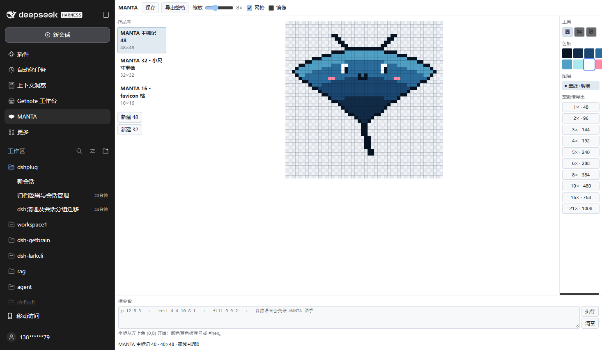

# dsh-pixel

像素 IP 工作台。把「像素标记」做成 DSH 左侧任务栏里的一个独立小应用：作品库、调色板、逐像素编辑、对话框指令，以及按原生网格整数倍导出的整套品牌资产。

这个插件起源于一个具体需求——给一个个人 IP（Manta）做像素标记，要求能按像素分辨率逐档放大、资产结构清楚、能被非美术的人接手改。做出来之后它是一个通用的像素 IP 工具，Manta 只是随包附带的示例作品。

---

## 它解决什么问题

生图模型画不出可交付的像素标记：边缘不对齐像素网格、调色板每张都不一样、同一个提示词重跑结果不同、放大会出现半像素。像素标记的交付物不是「一张图」，而是**一组有契约的资产**——原生网格、固定调色板、整数倍放大档位、最小尺寸的手工重绘版本。

所以这个插件把几何关系写死成契约，导出是「按契约重新生成整档」，不是「另存为一张 PNG」：

| 概念 | 值 |
|---|---|
| 原生网格 | 48 × 48 |
| 放大档位 | ×1 ×2 ×3 ×4 ×5 ×6 ×8 ×10 ×16 ×21 |
| 产出尺寸 | 48 / 96 / 144 / 192 / 240 / 288 / 384 / 480 / 768 / 1008 px |
| 采样方式 | 最近邻（每个源像素 = 一个整数方块，不插值） |
| 小尺寸 | 16 / 24 / 32 / 64 px 独立手绘，不是缩小版 |

64 px 是有意缺档的：48 × 4/3 不是整数，硬凑就会出现半像素。

---

## 安装

```powershell
& C:\dsh\dshplug\install.ps1 -Only dsh-pixel
```

装完**完全退出 DSH 再打开**。之后改这个插件的代码即时生效，不用再跑 install、也不用重启。

验证：

```powershell
& C:\dsh\dshplug\install.ps1 -Check
& C:\dsh\dshplug\install.ps1 -List
```

`-Check` 里 `dsh-pixel` 应显示 `link-junction`。

---

## 怎么用

左侧任务栏出现一个像素标记图标，点开就是工作台（全宽页面，不是侧栏探头）。



| 区域 | 做什么 |
|---|---|
| 左栏 | 作品库；「新建 48」「新建 32」按原生网格起一张新图 |
| 中间 | 画布，逐像素点画；当前颜色来自调色板 |
| 右栏 | 调色板（选中的色块是平面描边，不是立体按钮）、档位导出按钮 |
| 下方 | 指令框：`p 12 8 3` 打点、`rect 4 4 10 6 1` 矩形、`fill 9 9 2` 填充 |

### 两条修改路径

1. **自己改**：画布点画，或者指令框敲坐标命令。命令是确定性的，同样的输入永远得到同样的像素。
2. **对话改**：指令框里写自然语言，点「交给助手」。它会在对话里开一轮，把 `[MANTA Studio] <你的要求>` 送进 composer，走正常的工具链。

> 为什么是「送进对话」而不是「直接调模型」：Client 插件拿不到模型通道（`SERVICE_API` 里没有），宿主侧也因为 `@deepseek-ai/dsh-tools` 在 profile 里不可解析而做不成工具。送进 composer 反而是唯一可审计的路径——你能在对话历史里看到每次修改请求。

---

## 文件结构

```
dsh-pixel/
├── lib/
│   ├── index.js          宿主半：导出路由 /dsh-pixel（零依赖 PNG 编码器）
│   └── client.js         浏览器半：左侧小应用 + 右栏快捷入口
├── assets/               示例作品（Manta）与调色板
│   ├── mark/             主标记整档：16 … 1008 px + favicon.ico
│   ├── avatar/           头像
│   ├── lockup/           横排组合与字标
│   ├── expression/       表情（默认 / 眨眼 / 开心）
│   ├── palette.json      8 色调色板（设计源）
│   └── palette.pixel-studio.json  同色板的像素编辑器格式
├── tools/                开发期脚本（Pillow，不随插件加载）
│   ├── exports.py        从当前 48 主标记派生整数档（日常用这个）
│   ├── asset_build.py    用脚本里的绘制重画全部产物（会覆盖主标记）
│   └── bridge.py         与像素编辑器作品库互推
├── test/
│   ├── run.mjs           跑全部套件
│   ├── host.test.mjs     档位数学、PNG 字节、三处名字一致
│   └── client.test.mjs   用替身 Context 渲染两个半，断言注册结果
├── docs/
│   ├── ARCHITECTURE.md   为什么这么拆
│   ├── CONTRACT.md       资产契约与导出规则
│   ├── DEVELOPMENT.md    改代码 / 加档位 / 换 IP
│   └── CHANGELOG.md      版本记录
├── cordis.patch.yml      插件注册行
└── package.json          清单（dsh.bundle.patch + dsh.client）
```

---

## 自己的 IP 从这里开始

插件本身不带品牌：id、路由、模块名都是通用的 `dsh-pixel`。品牌集中在两处——

- `lib/client.js` 里的 `BRAND` 对象（显示名、助手称呼、文件名前缀）
- 宿主半导出的文件前缀来自文档的 `slug` 字段，Client 每次导出时附上

改这两处就能把工作台指向另一个 IP，不用动几何逻辑。详见 [docs/DEVELOPMENT.md](docs/DEVELOPMENT.md)。

---

## 测试

```powershell
node test/run.mjs
```

两套都通过才算数。`host.test.mjs` 会检查 `package.json` / `cordis.patch.yml` / `export const name` 三处名字一致、`list.json` 版本同步——这三处任何一处对不上，插件会静默不加载。

---

## 已知边界

- **不是编辑器内核**。大面积画布、历史、图层面板由像素编辑器插件（如 `@muxiuesd/dsh-pixel-studio`）负责；这里只做 IP 工作流与整档导出。宿主半不读写它的存储，写入走它的 `save`。
- **没有模型通道**。对话改走 composer 注入，见上文。
- **`.aseprite` 格式不支持**。导出是 PNG，图层结构保留在作品库里。
- **左右两半的名字必须三处一致**（`package.json` 的 `name`、`cordis.patch.yml` 的 `id`、`index.js` 的 `export const name`），改名要三处一起改。

---

## 许可

MIT。
